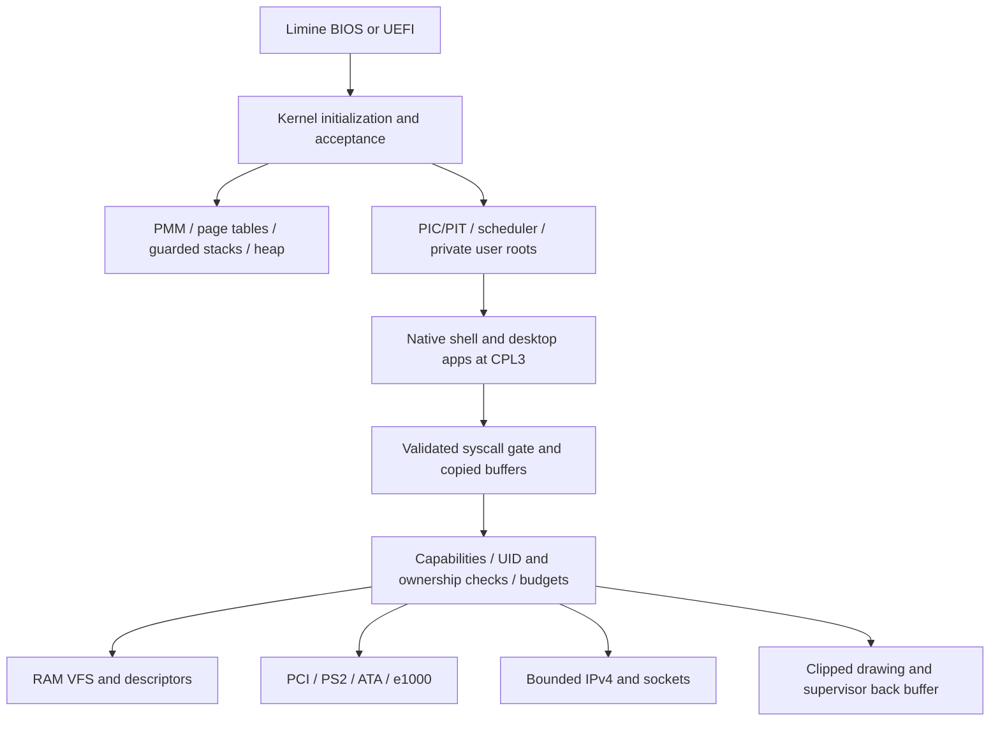
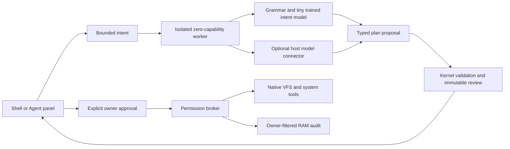

# AgenticOS architecture

AgenticOS has a custom C17/NASM x86_64 kernel booted by pinned Limine. The tested
machine is one QEMU q35 CPU. The kernel owns memory, descriptors, interrupts,
scheduling, files, device/network state and capability checks. Native apps use
an explicit ELF/syscall ABI and do not import a host runtime.

The kernel's upper mappings are supervisor-only. Every user process owns its
lower page tree and leaf pages; upper kernel subtrees are borrowed for the
kernel owner's lifetime. Code is RX, data RW/NX, and stacks have guards.
TSS.RSP0 and CR3 follow task selection. Every ISR saves a normalized register
frame; scheduling selects the frame returned by IRETQ. FPU/SIMD is deliberately
trapped because this ABI does not save that state. The target is integer code.

Syscalls check the actual running process/root and return context. User pointers
are validated over their entire range and copied through stable physical aliases.
Each process owns descriptors and sockets. Exit/fault/quota/cancel recursively
cancels descendants; off-current reaping releases their roots, leaves, stacks,
descriptors, sockets and PCB/TCB records. Fixed pools and optional CPU/syscall
budgets bound resources. See USER_MODE.md, SCHEDULING.md and SECURITY.md in docs.

The VFS stores RAM inodes/data, owner/mode/search/sticky permissions, independent
file offsets and open-unlink lifetimes. Exclusive temporary creation and atomic
regular-file replacement support safe editor saves. Files, settings and runtime
records are volatile. ATA is a tested block driver, not a mounted persistent
filesystem. PS/2 and e1000 use bounded polling; the network stack implements a
small static IPv4/socket subset documented in NETWORK.md.

The desktop's window model and built-in apps run in one private user process.
Its explicitly granted display capability permits copied drawing/input commands;
it never receives a framebuffer mapping. A supervisor back buffer is zeroed,
presented and freed at session exit. Built-in views share their process; child
programs launched by Terminal receive private roots and lose display permission.

All five agent milestones are implemented. A controller starts a bounded worker
with its own address space and zero direct tool capabilities. The worker uses
the offline grammar/trained integer classifier or an explicitly selected host
model connector, and proposes typed plan data. The kernel authenticates the
worker, copies/validates its plan and holds an immutable review record. Owner
approval permits one broker-controlled atomic action at a time, using the
owner's current capabilities and VFS UID. Cancellation stops future actions;
exit/deadline/quota cleanup reclaims workers and sockets. Model output cannot
grant privileges or approve execution. The shell and native Agent panel provide
review, deletion consent, status and owner-filtered RAM audit controls. See
[AGENT_WORKFLOWS.md](docs/AGENT_WORKFLOWS.md).

Build/release tooling lives on the host. It is separate from the guest kernel:
source versions, normalized paths, compact runtime images and fixed ISO metadata
produce repeatable images; QEMU and independent host tests collect evidence.
Physical hardware, SMP, production security, persistent storage, TLS and broad
hardware compatibility are outside the verified core release.
