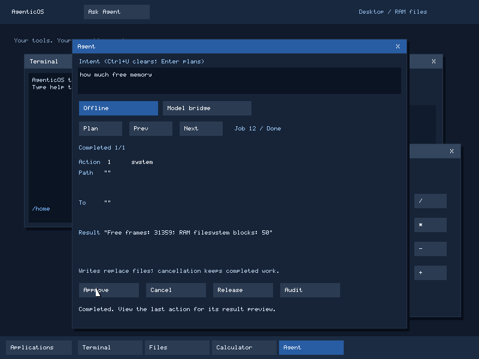

# Agent milestone 5 — native workflows and final agent release

Verified 2026-11-18. Version 0.19.0 completes all fourteen core phases and the
five planned agent milestones. The source remains a custom C17/NASM x86_64 OS,
with native processes and its own VFS/device/network/display/syscall services.
It is an educational QEMU release, not a production or broad-hardware OS.

The shell and desktop Terminal provide agent plan/model/review/approve/cancel/
status/jobs/audit/release commands. The native Ask Agent panel displays complete
immutable action fields, requires every action to be viewed, and requires an
additional deletion acknowledgment. Approved workers execute the bounded plan
one broker-controlled atomic action at a time. Completion shows a bounded result
preview; status preserves partial completion on cancel/failure. No model or
worker grants itself capabilities or approval.

Executed validation:

- `./scripts/env.sh make test-regression`: all targets completed without errors.
  Host ASan/UBSan suites, GDB, eight diagnostics plus restoration, fourteen memory,
  eighteen interrupt, twelve scheduler and twelve user guest checks passed.
  Device, shell, Ethernet/socket, desktop, permissions and application regressions
  passed on BIOS and UEFI, followed by all agent network/GUI/shell suites.
- Real PS/2 agent tests inspect the actual private controller address space,
  verify a full 127-byte literal survives the per-draw text limit, enforce
  every-action/deletion guards, approve a three-step workflow, read exact file
  contents independently through Terminal, query audit, cancel pending work and
  display offline/model failures. Workers use distinct CR3s; exit restores all
  physical frames. Serial tests independently exercise the same public APIs.
- Real e1000/TCP/HTTP provider-fixture tests cover valid model review/execution,
  unsafe/malformed output, provider errors, invalid magic/length, incomplete
  replies, timeout, in-flight cancellation and all eight socket slots reclaimed.
- `make release` produces identical full kernel ELF and ISO files in two clean
  builds, with an identical compact ISO from relocated source. `make test-release`
  boots that exact packaged ISO on BIOS and UEFI, requires fourteen core/five
  agent markers, executes a reviewed Agent request and verifies clean exit/halt.
- Python syntax compilation and `git diff --check` passed. The original desktop
  font's case folding/missing punctuation was corrected; sanitizer coverage checks
  all 95 printable glyphs and distinct case. Readable review now preserves path
  case and escaped literal data. Native images are checked against the existing
  VFS file limit; section garbage collection/desktop size optimization keeps the
  existing resource limits intact.

Logs: `/tmp/agent5-regression.log` and `build/tests/{agent-model,agent-ui,
agent-shell,release}-{bios,uefi}` in this workspace. Artifacts are in build/release
with checksums, manifest, tool/source metadata and independent build logs. After
committing, regenerate to record the exact clean commit; Git metadata is not
embedded in the runtime image.

```text
1861edd6b6a9e3fd9303d7a8b1ea98c3410b32a30aee9088909b5dd078c74c5e  agenticos-0.19.0.iso
f674b2a7577cafa0ac09098905b9044855d04cc8f958b53a60451674dbd75590  agenticos-0.19.0-kernel.elf
```

This is an unmodified framebuffer capture from the passing packaged BIOS ISO,
showing an approved offline Agent request and its real system result:



Offline inference uses the explicit grammar and a tiny trained intent classifier,
not an LLM. The optional connector is tested against a provider fixture; live
third-party model quality/availability requires user configuration and remains
unverified. Files, settings, jobs and audit are RAM-only. Tools are limited to
seven typed operations under /home, eight actions and 127-byte fields/previews;
there is no arbitrary command execution or whole-workflow rollback. Built-in
windows share their controller process; workers are isolated. Physical
installation has not been performed. See [AGENT_WORKFLOWS.md](../AGENT_WORKFLOWS.md),
[AGENT_INFERENCE.md](../AGENT_INFERENCE.md) and [USER_GUIDE.md](../USER_GUIDE.md).
