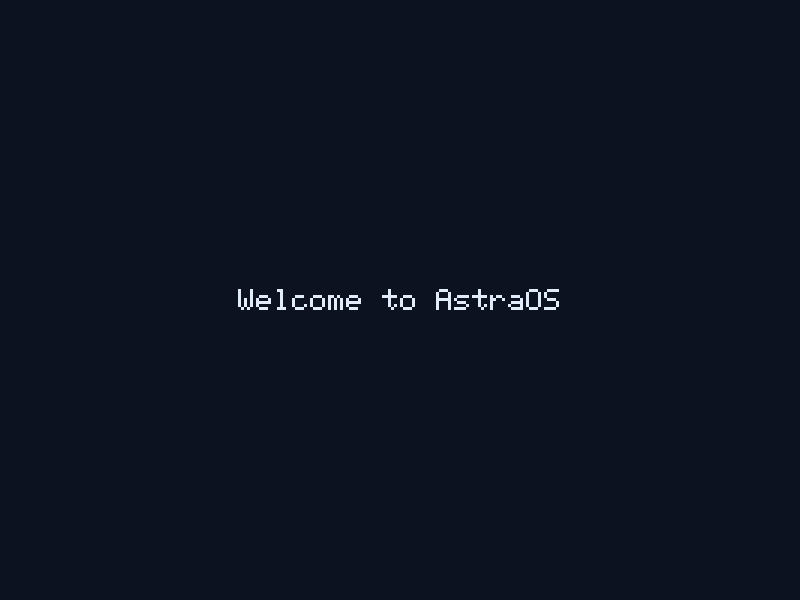

# Phase 1 acceptance report

Date: 2026-11-11. Scope: the first boot milestone from the project owner's brief.
Implementation branch: `feature/phase-1-first-boot`.

## Result

**Phase 1 passed on QEMU with both BIOS and UEFI.** The custom kernel executes
in x86_64 long mode, displays `Welcome to AstraOS`, records a success marker and
halts. No later milestone is marked implemented.



The capture is from the BIOS acceptance run. The UEFI capture has the same
800x600 pixel output. Both contain 1,917 foreground text pixels. The image was
visually inspected to confirm the wording; automated color checks alone would
not establish correct text.

## Environment and dependency preparation

Host: Debian 13.6 x86_64; GCC 14.2.0, Make 4.4.1, Python 3.12.14, Git 2.52.0.
New local tools: Clang/LLD 19.1.7, NASM 2.16.03, QEMU 10.0.13, GDB 16.3,
xorriso 1.5.6, SeaBIOS 1.16.3, OVMF 2025.02. Limine v8.7.0 is locked by
commit and archive SHA-256. See [setup](../SETUP.md) for exact package versions.

Commands were executed in `/workspace/AGENTIC-OPERATING-SYSTEM`:

```sh
git switch -c feature/phase-1-first-boot
./scripts/setup-debian.sh
./scripts/env.sh make -j2 iso check-elf test-host
./scripts/env.sh make test-debug
# Exercise a fresh dependency fetch and build after removing generated outputs:
./scripts/env.sh make distclean
./scripts/env.sh make -j2 iso check-elf test-host
# Final acceptance, including the license-bearing ISO:
./scripts/env.sh make test test-debug
```

The setup script was rerun successfully with cached packages. The documented
`make run` target was separately launched, checked for its success marker, and
stopped with SIGINT. All QEMU processes started for validation were stopped.

## Actual final test output

```text
PASS: ELF64 x86_64, static, higher-half entry, four W^X LOAD segments
PASS: framebuffer renders text, respects pitch, preserves buffer guards
PASS: alternate RGB layout and ten invalid framebuffer cases (ASan/UBSan)
PASS: BIOS boot, welcome, stable kernel HLT, screen 800x600, 1917 text pixels
PASS: UEFI boot, welcome, stable kernel HLT, screen 800x600, 1917 text pixels
PASS: GDB hardware breakpoint reached kernel_main with source symbols
```

Each firmware run produced this kernel serial sequence (UEFI firmware output
omitted from this excerpt):

```text
ASTRA: kernel entered
Welcome to AstraOS
ASTRA: PHASE1 PASS
```

QMP register evidence in the BIOS run included:

```text
RIP=ffffffff80001082 ... CPL=0 ... HLT=1
```

GDB stopped at `kernel_main` in `kernel/kernel.c`, at virtual address
`0xffffffff80001004`. The ELF entry is the NASM `_start`; GDB's hardware
breakpoint verifies execution has reached the C boot path, not only firmware.

The runner was also exercised with a 1 MiB zero-filled non-bootable image and
a 2-second timeout. It returned exit code 1 with `No first-boot success marker`.
This is an **expected negative-test failure**, not a passing boot. It is saved
in `build/tests/negative.log`; the final positive runs regenerated their own
independent BIOS/UEFI evidence afterward.

## Build artifacts from the acceptance run

| Artifact | Size | SHA-256 |
| --- | ---: | --- |
| `build/astraos.iso` | 3,903,488 bytes | `af558326737f495efdcd3904e180cc3f8f455e37f3d3a51a20b4de87e3df73e6` |
| `build/kernel.elf` | 28,880 bytes | `71b3dbd9a737f62c50ed57ef5b8913a4960f7ecd90404a38e247b5b1be8c4598` |

Fresh builds can have different ISO hashes because timestamps are not yet
normalized. Build products are ignored by Git; source, scripts, this report and
the unmodified captured screenshot are retained in the milestone commit.

## Errors investigated and resolved

- System APT could not write its state directories. Replaced the installation
  approach with signed-APT download/extraction into a user-owned tools directory.
- The initial C compile exposed a missing `<stddef.h>` for `NULL`; added it and
  rebuilt successfully under `-Werror`.
- The initial debugger test assumed GDB would print `hit Breakpoint`; GDB 16.3
  prints `Breakpoint 1, kernel_main ()`. Corrected the test's output assertion
  and reran it. The breakpoint itself had already been reached successfully.

No unresolved build or QEMU boot failure remains for Phase 1.

## Files and structure

Implemented boot assets under `boot/`; C entry under `kernel/`; x86_64 entry,
UART, port I/O and linker layout under `kernel/arch/x86_64/`; display code under
`kernel/drivers/display/`; setup and GDB scripts under `scripts/`; QEMU runner
under `tools/`; checks under `tests/`. `Makefile`, README, architecture, roadmap,
change log, contribution and test documentation were added/updated.

Future subsystem directories contain only `.gitkeep` files, not stub
implementations. See the [README tree](../../README.md#project-map).

## Limits and next gate

No allocator, kernel-managed paging, exception handling, timer, task switching,
syscalls, filesystem, keyboard, networking, agent runtime or native desktop.
No physical hardware, Secure Boot, installation or production-security testing.
The initial address mappings and descriptor tables are provided by Limine.

AI agents are planned as isolated user-space services with a policy-enforcing
tool broker; see [architecture](../../ARCHITECTURE.md). They are not implemented
or required to boot this milestone.

Reusable setup/start commands are saved in the repository. An attempt to save
`install_script` and `start_skill` through the environment draft API returned
`INVALID_ARGUMENT`; backend configuration persistence is **unconfirmed**.
This does not affect the current successful build/test results. The environment
has not been published or validated in a newly restored task.

Next: obtain owner approval for Phase 2 (structured logging, panic/assertions,
CPU information and kernel configuration), then implement and verify it.
