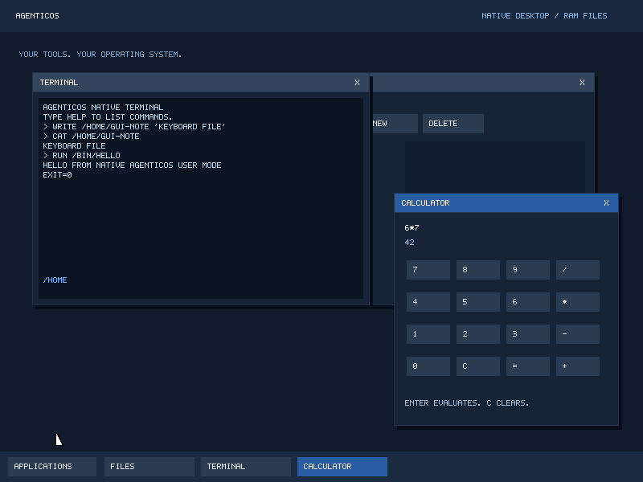

# Week 11 — native desktop

Verified 2026-11-18. A native CPL3 process owns the desktop's window model and
built-in app views; kernel syscalls copy and clip drawing commands and input.
The user process has no framebuffer mapping. A supervisor RW/NX back buffer
presents a complete frame and is fully freed after user-root destruction.

Executed successfully:

- `./scripts/env.sh make test`: strict kernel/native builds, ELF validation,
  existing sanitized suites, window focus/z-order/drag boundaries/quotas,
  calculator failures, renderer signed extremes/unterminated text/pitch guards,
  and default BIOS/UEFI bounded desktop batches with exact frame recovery.
- The final targeted ASan/UBSan display test additionally verifies buffered
  drawing does not modify the display until present and preserves pitch guards.
- `./scripts/env.sh make test-desktop`: BIOS and UEFI actual PS/2 input and real
  framebuffer captures. The test enters `6*7`, obtains 42, drags the calculator
  by (-100,-70), checks its new title-bar pixel, opens a file preview, writes and
  reads a file in the terminal, executes `/bin/hello`, focuses via the launcher,
  closes/reopens Calculator, exits and verifies kernel HLT plus resource recovery.
- `./scripts/env.sh make test-shell`: both bidirectional native serial sessions
  pass after sharing the command implementation with the graphical terminal.
- `git diff --check`: clean.

Repeated graphics testing exposed capture during a partial redraw. A software
back buffer now presents complete frames; the runner also waits for stable
framebuffer pixels. The final desktop test passes on both firmware paths.
Evidence: `build/tests/desktop-{bios,uefi}` includes initial, dragged, file-preview
and final unmodified screenshots, command/ISO digest, serial, results and CPU
registers. A captured framebuffer was inspected visually. The report image
below is copied from the passing BIOS run, not a mockup.



Default artifact SHA-256:

```text
38afda5863ebdc4488cb5222d184b546791ccac0a2554caef26c2d0f15befb0a  build/agenticos.iso
93266463cb6242a955f473113576369d03038e96f85ee91537f23eecb7870c9e  build/kernel.elf
```

Limits: software rendering, fixed window sizes, original capitalized 5x7 font,
800x600 tested, one process for built-in windows, one live window per app in the
launcher, volatile files and bounded text/child capture. Full application editing
and broader policy hardening remain Phases 13 and 12. See [DESKTOP.md](../DESKTOP.md).
