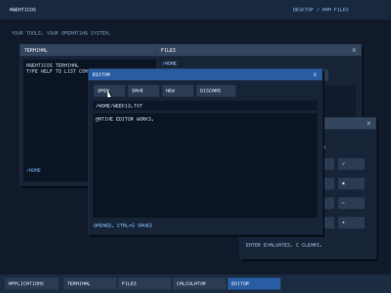

# Week 13 — native applications

Verified 2026-11-18. The native desktop now provides Editor, Calculator, Files,
Monitor, Terminal and Settings. Built-in app views share the compositor process;
external terminal programs remain separately isolated. Editor supports insertion,
arrows/Delete, Ctrl shortcuts and unsaved-draft protection. Its exclusive temporary
writes commit through atomic replacement. Monitor reads real PMM/task records;
Settings saves appearance in the RAM filesystem. Calculator has checked signed
integer expressions, precedence, parentheses and a bounded parser.

Executed successfully:

- `./scripts/env.sh make test`: strict builds/ELF checks, existing sanitizer
  suites, exclusive-create and atomic replace/open-reader tests, modifiers,
  expression boundaries and 20,000 calculator inputs; BIOS/UEFI acceptance.
- The native app batch saves/reopens exact text, fills the RAM data quota,
  verifies save fails without changing the original, frees all filler blocks,
  exercises the monitor/settings and restores its physical frames and FS blocks.
- `./scripts/env.sh make test-applications`: BIOS/UEFI real keyboard/mouse
  editor insertion, Ctrl+S, unsaved-close rejection, discard/reopen, exact saved
  bytes, expression result 9, real monitor memory values and saved theme bytes.
  Independent QMP physical page walks read the native ELF's private user mapping,
  proving actual loaded contents rather than accepting a status string alone.
- `./scripts/env.sh make test-desktop`: both graphical regression workflows pass.
- `./scripts/env.sh make test-shell`: both serial sessions pass after interactive
  startup moves behind all boot acceptance checks; exit reclaims resources.
- `git diff --check`: clean.

Testing caught the first calculator key reaching the previous focus before QEMU
had delivered the earlier mouse selection. Tests now wait for focus/path-entry
acknowledgment before keyboard input. Both firmware app workflows pass after
this synchronization fix. Input also consumes queued events before another
hardware batch. Failed screenshots/state were retained for diagnosis.

Evidence: `build/tests/applications-{bios,uefi}` contains exact saved bytes and
memory values in `results.json`, serial/commands/registers and unmodified editor,
monitor and settings screenshots. Captured app output was inspected visually.



Default artifact SHA-256:

```text
5dd62fccb5f9041a2b0e15579dc29e13ac2ab79897b64d0b01b15f2d7f2beb15  build/agenticos.iso
ec0e42af2913be9684ad0023bf144a5226673c752dd6375e90bb485950f4aefa  build/kernel.elf
```

Limits: ASCII/4095-byte editor, no undo/clipboard or concurrent-edit merge;
63-byte/eight-depth integer calculator; fixed-size built-in windows in one
process; coarse runtime counters and volatile files/settings. Supported UI
controls and persistence semantics are documented in [APPLICATIONS.md](../APPLICATIONS.md).
