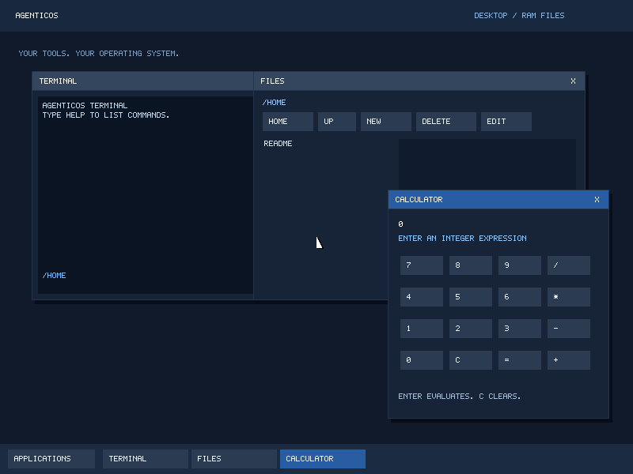

# Week 14 — repeatable core release

Verified 2026-11-18 with the pinned Debian/Clang/LLD/NASM/QEMU toolchain.
The core release is version 0.14.0, experimental native ABI 2. It has a custom
kernel, private native processes, RAM files/permissions, tested devices/network,
serial shell and graphical apps. It remains a bounded single-CPU QEMU release.

Executed successfully on the final code:

- `./scripts/env.sh make test-regression`: exit zero. All sanitized host suites,
  normal BIOS/UEFI, GDB source entry, eight diagnostic boots plus configuration
  restoration, 14 memory checks, 18 interrupt checks, 12 scheduler checks,
  12 user checks, negative readiness checks, real driver, serial shell,
  Ethernet/socket, graphical desktop, security and native application checks pass.
- `./scripts/env.sh make release test-release`: exit zero. Two clean independent
  output builds produce byte-identical full kernel ELFs and runtime ISOs. A third
  build from relocated source reproduces the compact ISO. Both exact packaged
  firmware boots reach fourteen core stage markers and READY, run the live
  desktop, exit, reclaim resources and halt in the kernel.
- `git diff --check` and Python syntax validation: clean.

The full regression exposed QEMU mouse/keyboard delivery races in the graphical
automation. Tests now await guest pointer/button or key acknowledgments and the
following completed frame. Key characters are not logged. The final full suite
passes on both firmware paths after this fix.

Artifacts are under `build/release`, with manifest, SHA256SUMS and independent
build logs. The manifest records the exact commit/dirty state, source-tree digest,
epoch, tool versions and sizes/hashes. Regenerate after committing to obtain the
clean commit manifest; no Git metadata is embedded in the image. Full debug ELFs
retain NASM/system-header source roots, so their equality proof uses one source
root. The stripped runtime ISO is separately verified across source relocation.

```text
ecd1eef4e0901ad77c5564c56a08b554f8451fcc6806fed16f7738c99b9f8cef  agenticos-0.14.0-kernel.elf
eaa23c134d29a9514eaf8bf42329affa42bda09ffd582b572ae6da563f3ef094  agenticos-0.14.0.iso
```

Evidence: `build/tests/release-{bios,uefi}` contains the packaged ISO digest,
command, serial, registers and unmodified live desktop/final-halt captures.
The final aggregate log is `/tmp/phase14-regression-final.log` in this workspace;
individual runner evidence remains under `build/tests`. This screenshot was
captured from the passing packaged BIOS ISO and inspected visually.



[USER_GUIDE.md](../USER_GUIDE.md), [RELEASE.md](../RELEASE.md) and
[HARDWARE_TESTING.md](../HARDWARE_TESTING.md) describe exact commands and limits.
Files/settings are volatile. Broad hardware, persistent filesystems, SMP, TLS,
production security and physical installation are outside the verified core.
The owner-authorized agent milestones follow this core release; they are not
claimed by Week 14 itself. Earlier reports/images are preserved unchanged.
