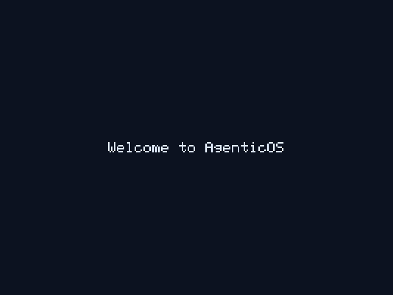

# Week 2 / Phase 2 acceptance report

Date: 2026-11-11. Scope: kernel foundation, following owner approval of Week 2.
Development branch: `feature/phase-2-kernel-foundation`.

## Result

**Phase 2 passed.** AgenticOS now has sequence-numbered logging, bounded
formatting, fatal panic/assertion diagnostics, CPUID reporting, COM1 loopback
verification, a nonblocking UART receive primitive and validated build options.
The normal image boots successfully under BIOS and UEFI and retains the visible
welcome. Deliberate panic and assertion images stop with the expected reason
and do not report successful foundation initialization.

The owner confirmed the AgenticOS name during this milestone. Current banners,
boot labels, artifact names, include guards, environment option names and docs
use it. Original Week 1 reports/screenshots retain their historical AstraOS
branding. The newer GitHub README commit `3cef3dd` was preserved as the base of
this work. No earlier commit was rewritten.



Both normal firmware runs captured an 800x600 display with 2,124 foreground
pixels; the captured wording was also visually inspected.

## Commands executed

In `/workspace/AGENTIC-OPERATING-SYSTEM`, using the existing pinned Debian
Clang/LLD 19.1.7, NASM 2.16.03, QEMU 10.0.13 and GDB 16.3 toolchain:

```sh
git switch -c feature/phase-2-kernel-foundation
./scripts/env.sh make test                    # establish the Week 1 baseline
git fetch origin main
git merge --ff-only origin/main               # preserve the owner's README edit
./scripts/setup-debian.sh                     # validate renamed tool activation
./scripts/env.sh make clean
./scripts/env.sh make -j2 iso
./scripts/env.sh make test test-debug test-foundation
```

No new system dependencies were required. The setup refresh reused the signed,
verified Week 1 package cache. Existing `/workspace/.astra-tools` is supported;
fresh installations default to `.agenticos-tools`. No physical disks were
attached or modified.

## Validation evidence

| Check | Observed outcome |
| --- | --- |
| Freestanding C17/NASM build, strict warnings as errors | Passed |
| ELF64/static/higher-half/W^X layout | Passed for default and diagnostic images |
| Framebuffer bounds, pitch, masks and invalid-input regressions | Passed under ASan/UBSan |
| Formatting extrema, pointers, truncation, guards and unsupported syntax | Passed under ASan/UBSan |
| All five log levels, filtering/reset, controls, missing sink and truncation | Passed under ASan/UBSan |
| Assertion single evaluation and panic source/disable/stop behavior | Passed under ASan/UBSan with architecture stubs |
| Synthetic CPUID vendor/brand, leaf guards and family/model rules | Passed under ASan/UBSan |
| Configuration rejection, unchanged mtime and restoration | Passed |
| Default INFO/normal BIOS and UEFI boots | Both passed; CPU halted inside kernel with IF clear |
| DEBUG/logs BIOS and UEFI | Both passed; all four nonfatal levels observed |
| WARNING/logs BIOS and UEFI | Both passed; INFO/DEBUG absent |
| PANIC/panic BIOS and UEFI | Both expected fatal outcomes verified; no Phase 2 completion |
| DEBUG/assert BIOS and UEFI | Both expected fatal outcomes verified; failed expression reported |
| Same-directory INFO -> DEBUG/logs -> INFO | Restored ELF hash matched original; restored image booted under BIOS |
| GDB hardware breakpoint at `kernel_main` | Passed with source symbols |
| Normal-boot checker given the intentional panic ISO | Correctly rejected with exit 1 despite the earlier Phase 1 marker |

The test matrix's eight diagnostic boots are distinct from its final restored
normal BIOS boot. The default BIOS/UEFI acceptance boots are separate. Fatal
probes are successful **host tests of expected failure**, not successful kernel
initializations. No fatal image is the default release artifact.

Normal serial excerpt from the final default image:

```text
AGENTICOS: kernel entered
[1] [INFO] [boot] AgenticOS 0.2.0: initializing bootstrap CPU
[2] [INFO] [boot] Welcome to AgenticOS
[3] [INFO] [cpu] vendor=AuthenticAMD family=15 model=107 stepping=1
[4] [INFO] [cpu] brand=QEMU Virtual CPU version 2.5+
[5] [WARNING] [boot] Interrupts disabled; exception handlers are not installed yet
AGENTICOS: PHASE1 PASS
[6] [INFO] [boot] Kernel foundation initialized; halting
AGENTICOS: PHASE2 PASS
```

The warning is an explicit statement of the current architecture, not an
unexplained boot failure. CPU data describes the emulated guest CPU.

Intentional failure excerpts:

```text
[1] [PANIC] [panic] kernel/kernel.c:68 kernel_main: intentional panic probe
[8] [PANIC] [panic] kernel/kernel.c:70 kernel_main: assertion failed: 2 + 2 == 5
```

Each line is from a different image/run. Each run had one PANIC record, IF clear,
HLT set, one kernel entry and no `AGENTICOS: PHASE2 PASS`. Current generated
logs, screenshots, CPU registers and exact commands are under
`build/tests/{bios,uefi,bios-logs-debug,...}/`. The reconfiguration run uses
`build/tests/bios-restored`; the deliberately rejected run uses
`build/tests/bios-unexpected-panic`. The aggregate negative-check output is
`build/tests/runner-negative.log`.

## Default artifacts from the acceptance run

| Artifact | Size | SHA-256 |
| --- | ---: | --- |
| `build/agenticos.iso` | 3,926,016 bytes | `cd25f1a4ca35d76479bd24731fa5f3f0b2af32ab278d9669962e452c4de2e24d` |
| `build/kernel.elf` | 51,256 bytes | `2884ceabd034e9a42e9c13158470cfbc16443a5c63b888e23c433089bb8e8158` |

The normal and diagnostic builds use separate output directories. ISO timestamps
are not normalized, so subsequent builds need not have the same ISO hash.
The same-directory kernel ELF restoration was independently checked by hash.

## Implementation map and concepts

- `kernel/debug/format.*`: a small freestanding formatter, with bounded writes
  and explicit unsupported-format errors rather than a host libc dependency.
- `kernel/debug/log.*`: severity filtering and sequence-numbered single-line
  records, using a borrowed sink callback and stack buffers instead of a heap.
- `kernel/debug/panic.*`: always-on invariants and fatal diagnostics.
- `kernel/arch/x86_64/{cpuid,diagnostics}.c`: actual CPUID and privileged CLI/HLT;
  portable logic remains testable without executing privileged host instructions.
- `kernel/cpu/info.*`: maximum-leaf checks and architectural family/model decoding.
- UART and initialization changes: tested loopback, deterministic stage ordering
  and source-specific panic for failed boot prerequisites.
- `tools/configure.py`: validated, change-sensitive build configuration.
- `tests/`: sanitizer coverage, configuration and real-guest fatal-path checks.

See [the foundation walkthrough](../KERNEL_FOUNDATION.md) for the concepts and
ownership rules. Record counters are not timestamps; a PANIC log level is not
itself a fatal stop; feature availability is not driver initialization.

## Remaining limitations and next approval

The logger assumes one CPU with interrupts disabled and a nonrecursive sink.
It is not SMP/NMI safe, persistent or a general printf implementation. Panic
details appear on serial, not on the framebuffer. UART timeouts can drop output;
the receive primitive is not an interactive shell. No exception recovery or
stack unwinding is implemented.

Memory management, interrupts/IDT, processes, syscalls, filesystem, networking,
native desktop, permissions and the AI/agent runtime remain future milestones.
No hardware portability, physical boot, Secure Boot or production security
claim is made. No unresolved build or expected-path test failure remains.

**Next milestone: Phase 3 / Week 3 — memory management, pending owner approval.**
