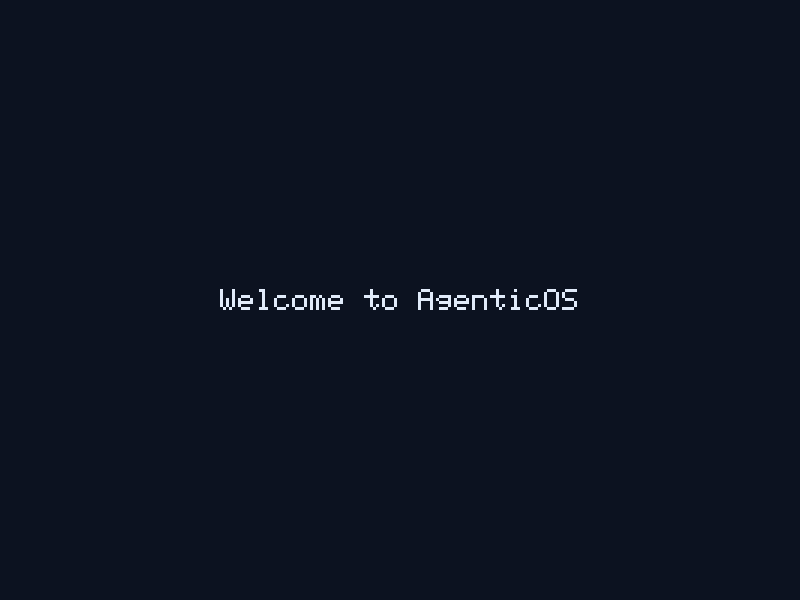

# Week 3 / Phase 3 acceptance report

Date: 2026-11-14. Scope: memory management, following owner approval of Week 3.
Development branch: `feature/phase-3-memory-management`.

## Result

**Phase 3 passed for the documented QEMU configurations.** AgenticOS 0.3.0
allocates and frees physical frames, builds its own four-level page tables,
switches CR3, enforces supervisor write protection and NX, and provides a
256 KiB kernel heap with two unmapped boundary guards. Normal images verify
memory contents, mappings and allocator recovery before reporting PHASE3 PASS.

All 14 memory guest checks passed, alongside the existing BIOS/UEFI, sanitizer,
debugger and foundation regressions. Six of those 14 checks deliberately cause
CPU page faults in isolated test images; they are successful host tests of
expected faults, not successful normal kernel initialization. The default image
does not contain that test-only page-fault handler.



The final BIOS/128 MiB memory run captured this 800x600 framebuffer, with 2,124
foreground pixels. The wording was visually inspected. Its kernel ELF matches
the default acceptance ELF by SHA-256; each scenario's ISO hash is separately
recorded because ISO timestamps differ.

## Commands executed

From `/workspace/AGENTIC-OPERATING-SYSTEM`, using the existing pinned Debian
Clang/LLD 19.1.7, NASM 2.16.03, QEMU 10.0.13 and GDB 16.3 toolchain:

```sh
./scripts/env.sh make test                   # establish the Week 2 baseline
git fetch origin main
git switch -c feature/phase-3-memory-management

# Final acceptance, after the implementation and review fixes:
./scripts/env.sh make -j2 iso
./scripts/env.sh make test test-debug test-foundation test-memory
```

No new system dependencies were required. No physical disks were attached or
modified. Cloud environment configuration was not changed or published.
The Week 1 and Week 2 reports and screenshots remain historical evidence.

## Validation evidence

| Check | Observed outcome |
| --- | --- |
| Freestanding C17/NASM, strict warnings as errors | Passed |
| ELF64/static/higher-half/four W^X LOAD segments | Passed for default and all matrix images |
| Physical allocator: alignment, holes, reservations, frame zero, exhaustion/recovery, invalid frees | Passed under ASan/UBSan |
| Malformed/overlapping/overflowing memory maps and metadata buffer bounds | Rejected as expected under ASan/UBSan |
| Heap: alignment, overflow/exhaustion, fragmentation/coalescing, invalid frees, corruption | Passed under ASan/UBSan |
| Heap: 2,048 deterministic allocation/free steps with live data checks | Passed under ASan/UBSan |
| Page tables: canonical addresses, flags, translation, shared path lifetime, data ownership | Passed under ASan/UBSan |
| Page tables: partial path allocation failure and exact rollback, active-space destruction refusal | Passed under ASan/UBSan |
| Page tables: active invalidation hooks and rejection of cache-policy changes via protect | Passed under ASan/UBSan |
| Freestanding memcpy/memmove/memset/memcmp versus libc, including overlapping moves | Passed under ASan/UBSan |
| Existing framebuffer, formatter, logging, assertions, CPUID and configuration checks | Passed |
| Default BIOS and UEFI boot checks | Passed with PHASE3 PASS, IF clear, high-kernel HLT and welcome capture |
| GDB hardware breakpoint at kernel_main | Passed with source symbols |
| Eight foundation diagnostic boots plus same-directory configuration restoration | Passed; restored ELF hash matched and normal BIOS boot passed |
| Fault image presented to the normal memory checker | Correctly rejected with exit 1 despite PHASE2 and PAGEFAULT markers |
| ANSI-interleaved bootloader panic detection | Passed |

The separate memory matrix executed these **14 guest checks**:

| Image | BIOS RAM | UEFI RAM | Observed outcome |
| --- | --- | --- | --- |
| Normal | 32, 128, 512 MiB | 128, 256, 512 MiB | All six completed PHASE3 |
| Read-only write | 128 MiB | 128 MiB | Both produced #PF error 0x3; original data unchanged |
| NX instruction fetch | 128 MiB | 128 MiB | Both produced #PF error 0x11; RIP matched the attempted fetch |
| Unmapped heap guard read | 128 MiB | 128 MiB | Both produced #PF error 0x0 at the guard |
| Physical-frame exhaustion | 128 MiB | 128 MiB | Both recovered every free frame, reran self-checks and completed PHASE3 |

The exhaustion runs allocated and recovered 32,187 frames under BIOS and
30,589 under UEFI. Different firmware reservations account for differing counts.
Each memory run also checked the actual CR3 against the newly logged root,
CR0.WP, EFER.NXE, four-level mode, CPL 0, IF clear, kernel HLT and framebuffer
output after the switch. Tests use QMP to stop their own VM and require exit 0.

Final BIOS/128 MiB normal serial excerpt:

```text
[7] [INFO] [memory] PMM managed=32326 free=32326 frames; page_size=4096
[8] [INFO] [memory] activating kernel CR3=0x55000 with 72 table frames
[9] [INFO] [memory] heap=262144 bytes; guard pages=2; supervisor WP=1 NX=1
[10] [INFO] [memory-test] PMM allocate/free and VMM alias/protect/remap/unmap passed
[11] [INFO] [memory-test] heap alignment, cross-page data, invalid-free and coalescing passed
[12] [INFO] [boot] Memory foundation initialized; halting
AGENTICOS: PHASE3 PASS
```

QMP reported CR0 `0x80010011`, CR3 `0x55000`, CR4 `0x20`, EFER `0xd00`,
RIP `0xffffffff80001242` and HLT 1 for that run. The UEFI/128 MiB normal run
reported CR3 `0x2000`, with the same protection bits and halted kernel RIP.

Examples from separate expected-fault images:

```text
[12] [INFO] [memory-probe] readonly fault: address=0xffffd10000000000 error=0x3 ip=0xffffffff80005b32
[12] [INFO] [memory-probe] nx fault: address=0xffffd10000000000 error=0x11 ip=0xffffd10000000000
[12] [INFO] [memory-probe] guard fault: address=0xffffd00000000000 error=0x0 ip=0xffffffff80005bfe
```

Each fault run emitted PAGEFAULT PASS and halted without PHASE3 PASS. The
minimal fixture installs only vector 14 and never resumes the faulting code.

Generated evidence is under `build/tests/`: default `bios`/`uefi`, foundation
scenario directories, `debug`, and `memory-{firmware}-{scenario}-{RAM}m`.
Memory directories contain exact QEMU argv and ISO SHA-256 in `command.json`,
serial/emulator logs, CPU registers and framebuffer captures. Builds use
isolated directories, and runners remove known stale outputs before launch.
The final aggregate output is saved locally as `build/week3-validation.log`.
The negative-readiness check is `build/tests/memory-runner-negative.log`.

## Default artifacts from the final acceptance run

| Artifact | Size | SHA-256 |
| --- | ---: | --- |
| `build/agenticos.iso` | 3,983,360 bytes | `3bca6c4d4eede8c60a3f3988e5e53998b1da7024bcca858d6880335597656a96` |
| `build/kernel.elf` | 108,928 bytes | `cf1601292320eb4ada739d499fc4dab734435779759ac5b497f35b5af485a1d2` |

Generated binaries and raw test output are ignored by Git; source, tests,
explanations, this report and the actual screenshot are committed. ISO timestamps
are not normalized, so a later rebuild can have a different ISO hash.

## Implementation map

- `kernel/memory/pmm.*`: validated physical ranges, eligibility/allocation
  bitmaps, metadata reservation, next-fit frame allocation and checked free.
- `kernel/arch/x86_64/paging.c` and `kernel/memory/vmm.h`: supervisor-only 4 KiB
  map/query/protect/unmap, table ownership, rollback and cleanup.
- `kernel/arch/x86_64/memory.*`: CR3 activation, WP/NXE and TLB operations,
  including flushing inherited global entries during the address-space switch.
- `kernel/memory/heap.*`: aligned first-fit blocks, split/coalesce and bounded
  metadata validation. `init.*` constructs the owned address space and guarded
  heap, then checks real memory contents and recovery in the guest.
- `kernel/runtime/memory.*`: freestanding compiler memory primitives.
- Limine requests, page-aligned linker boundaries and four-level boot option:
  connect boot metadata and section permissions to the owned address space.
- `tests/memory*`, `tests/runtime_memory_test.c` and `tests/guest/`: host
  algorithms, real-CPU protection probes, RAM matrix and readiness rejection.

See [the memory walkthrough](../MEMORY.md) for address layout, fragmentation,
ownership rules, page-fault error bits and the distinction between algorithm
tests and actual CPU permission enforcement.

## Known limitation and next milestone

Optional low-memory UEFI experiments did not reach kernel entry: 32 MiB timed
out in the firmware/loader path, while 64 MiB produced Limine's
`PANIC: High memory allocator: Out of memory` with a trace through
`ext_mem_alloc_type_aligned_mode`, `init_memmap` and `uefi_entry`. These are
recorded failures, not accepted boot configurations. Use **at least 128 MiB for
UEFI** with the pinned toolchain. BIOS/32 MiB is independently verified.

Allocation and page-table edits assume one serialized bootstrap CPU. The heap
is fixed-size; guards do not catch all object overflows or use-after-free.
Bootloader/ACPI memory is not reclaimed. There is no demand paging, swap,
SMP synchronization, user address space or general exception recovery. Full
interrupt handling, scheduling, filesystems, networking and the AI/agent runtime
remain later milestones. Physical hardware and Secure Boot are unverified.

**Next milestone: Phase 4 / Week 4 — interrupts and general exception handling,
pending owner approval.**
