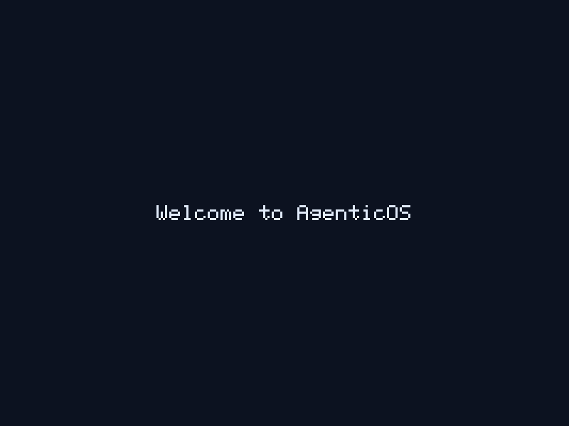

# Week 4 / Phase 4 acceptance report

Date: 2026-11-15. Scope: interrupts and exception handling, following owner
approval of Week 4. Development branch: `feature/phase-4-interrupts`.

## Result

**Phase 4 passed for the documented QEMU target.** AgenticOS 0.4.0 loads its own
GDT, 256-entry IDT and 64-bit TSS, dispatches returning IRQs, and reports fatal
CPU exceptions with saved registers. Dedicated IST stacks support double fault,
NMI and machine check. The tested interrupt backend is the 8259-compatible PIC
and 8254-compatible PIT, on a single q35/qemu64 CPU.

Normal boot verifies memory, all 15 GPRs and flags across interrupt return, and
at least eight actual timer IRQs with matching acknowledgements. It masks the
PIC, clears IF, reports PHASE4 PASS and halts. It does not start a scheduler.

The final full suite passed: **18 interrupt guest checks**, the **14 memory
guest checks**, sanitized host tests, default BIOS/UEFI boots, GDB, and the
existing foundation diagnostic/reconfiguration regressions. Sixteen interrupt
checks deliberately end in fatal CPU exceptions. These are successful host
tests of expected faults, not successful normal kernel initializations.



This is the final BIOS normal interrupt run's actual 800x600 capture, with
2,124 foreground pixels. Its wording was visually inspected. The matching
normal-scenario kernel ELF and default acceptance ELF have identical SHA-256.

## Commands executed

Using the existing pinned Debian Clang/LLD 19.1.7, NASM 2.16.03, QEMU 10.0.13
and GDB 16.3 tools, from `/workspace/AGENTIC-OPERATING-SYSTEM`:

```sh
./scripts/env.sh make test                 # establish the Week 3 baseline
git fetch origin main
git switch -c feature/phase-4-interrupts

# Final acceptance after implementation and review:
./scripts/env.sh make -j2 iso
./scripts/env.sh make test test-debug test-foundation test-memory test-interrupts
```

The checkout and remote main both started at Week 3 commit `e88fd81`.
No new system dependencies were needed. No physical disks were attached or
modified, and cloud environment configuration was not changed or published.
Earlier acceptance reports and screenshots retain their historical contents.

## Validation evidence

| Check | Observed outcome |
| --- | --- |
| Freestanding C17/NASM build, strict warnings as errors | Passed |
| Static ELF64, high entry, four page-aligned W^X LOAD segments | Passed for default and scenario images |
| GDT/TSS base/limit/type fields and all 256 IDT gates | Passed under ASan/UBSan |
| Descriptor bad inputs without partial writes | Passed under ASan/UBSan |
| PIC ICW sequence, masks/cascade, slave-first EOI and both spurious rules | Passed under ASan/UBSan with fake port callbacks |
| PIT bounds, rounded divisor and low/high programming bytes | Passed under ASan/UBSan |
| Actual GDTR/IDTR, TR, CS and hardware-written TSS busy bit in guest memory | Verified in all 18 interrupt runs |
| Actual software INT entry/IRETQ return | Distinct high-bit values in all 15 GPRs, original RSP and CF/DF preserved; live DF/IF clear |
| Controlled software IRQ7/15 | Both spurious dispatcher paths returned with expected counters |
| Normal BIOS and UEFI timer checks | Eight IRQs and eight EOIs observed per run, saved IF set on IRQ entry |
| All existing framebuffer, diagnostics, configuration, allocator, VMM and runtime tests | Passed under ASan/UBSan where applicable |
| Default BIOS/UEFI boot and GDB breakpoint at kernel_main | Passed |
| Eight foundation diagnostic boots and configuration restoration | Passed; restored normal ELF hash matched and BIOS boot passed |
| Fourteen BIOS/UEFI memory checks | Passed, including OOM recovery and Week 3 protection observers through the owned ISR |
| Fatal image presented as normal after PHASE3/IRET | Correctly rejected with exit 1; no PHASE4 completion |
| Earlier readiness rejection and ANSI bootloader panic detection | Passed |

The interrupt matrix executed these nine cases on **both BIOS and UEFI at
128 MiB** (18 checks):

| Case | Actual CPU result |
| --- | --- |
| Normal | PHASE4 PASS after descriptor, return and PIT checks |
| Divide by zero | Vector 0, error 0, exact DIV instruction RIP |
| Invalid opcode | Vector 6, error 0, exact UD2 instruction RIP |
| Invalid data selector | Vector 13, error 0x28, exact MOV-to-DS RIP |
| Unmapped read | Vector 14, error 0, exact CR2/RIP and decoded flags |
| Unusable normal stack | Real double-fault escalation, vector 8, error 0, saved bad RSP and handler on IST1 |
| Injected NMI | QMP inject-nmi with IF clear, vector 2, handler on IST2 |
| Read-only write | Vector 14, error 0x3, exact read-only address/RIP and decoded write flag |
| NX fetch | Vector 14, error 0x11, RIP=CR2 in the NX heap and decoded fetch flag |

All runs ended halted in the kernel at CPL 0 with IF clear and retained the
welcome. Fatal images emitted EXCEPTION HALT without PHASE4 PASS. Normal tests
reject kernel errors/panics and require PHASE4, rather than accepting an earlier
phase marker. Expected exception instructions are checked against symbols in
the corresponding ELF. The double-fault abort RIP is not treated as recoverable.

Final normal BIOS serial excerpt:

```text
[5] [INFO] [interrupt] GDT=0xffffffff800180f0 limit=39 IDT=0xffffffff80018180 limit=4095 CS=0x8 SS=0x10 TR=0x18 TSS_busy=1
[6] [INFO] [interrupt] 256 gates; dedicated IST: double-fault=1 NMI=2 machine-check=3
[7] [INFO] [interrupt] PIC vectors=32..47; all IRQs masked; IF=0
...
[16] [INFO] [interrupt-test] IRETQ preserved 15 GPRs, RSP, CF/DF; live DF/IF clear; spurious IRQ7/15 passed
AGENTICOS: IRET PASS
[17] [INFO] [timer] PIT input_hz=1193182 divisor=11932 ticks=8 eoi=8 saved_IF=1; PIC masked, IF=0
AGENTICOS: TIMER PASS
[18] [INFO] [boot] Interrupt foundation initialized; halting
AGENTICOS: PHASE4 PASS
```

Actual QMP state for that run included GDTR `0xffffffff800180f0`, limit `0x27`,
IDTR `0xffffffff80018180`, limit `0xfff`, TR selector `0x18`, and TSS limit `0x67`.
CR0 was `0x80010011`, CR3 `0x55000`, CR4 `0x20`, EFER `0xd00`, and the final RIP
`0xffffffff80001272` with HLT 1. The UEFI normal run used CR3 `0x2000` with the
same descriptor locations and protection bits.

QEMU labels its cached TR `TSS64-avl`; actual guest GDT memory independently
contained TSS descriptor `0x80008b0181180067`, whose type is busy (`0xb`). The
kernel also verifies the hardware-updated memory type after LTR. The initial
harness required the cached label to say busy; inspecting the real descriptor
resolved that incorrect assumption before final acceptance.

Examples from separate final fatal runs:

```text
[17] [PANIC] [exception] vector=8 name=double fault error=0x0 rip=0xffffffff8000795c cr2=0xffffd000000007f8
[18] [PANIC] [exception] cs=0x8 ss=0x10 rflags=0x93 rsp=0xffffd00000000800 stack=1

[17] [PANIC] [exception] vector=2 name=non-maskable interrupt error=0x0 rip=0xffffffff80006a82 cr2=0x0
[18] [PANIC] [exception] cs=0x8 ss=0x10 rflags=0x10046 rsp=0xffffffff80029170 stack=2

[17] [PANIC] [exception] vector=14 name=page fault error=0x11 rip=0xffffd00000001020 cr2=0xffffd00000001020
[23] [PANIC] [page-fault] present=1 write=0 user=0 reserved=0 fetch=1 pkey=0 shadow_stack=0 sgx=0
```

The first excerpt is BIOS double fault; the next two are UEFI NMI and NX.
Each full dump also contains all 15 saved GPRs. Serial severity PANIC indicates
an expected fatal probe here; these images are separate from the default ISO.

Generated evidence is under `build/tests/interrupt-{firmware}-{scenario}/`:
exact QEMU argv, ISO/ELF SHA-256 and QMP actions in `command.json`, serial and
emulator logs, `registers.txt`, `gdt-memory.txt` and actual framebuffer captures.
Other suites retain their own evidence directories. The final aggregate output
is saved locally as `build/week4-validation.log`; readiness rejection output is
`build/tests/interrupt-runner-negative.log`. Runners remove stale known outputs,
enforce deadlines, require clean QMP shutdown and clean up their own processes.

## Default artifacts from the final acceptance run

| Artifact | Size | SHA-256 |
| --- | ---: | --- |
| `build/agenticos.iso` | 4,026,368 bytes | `98bf8c81dacae9ba1c47a63aa85e8fdc09ce4a173533df81850dc58946c11f88` |
| `build/kernel.elf` | 153,432 bytes | `c67313ec37ee24e8761e19590d61a586cf41eb45a1372e4cc659e10df1590e71` |

Generated binaries and raw logs are ignored by Git. Source, tests, explanations,
this report and the actual screenshot are committed. ISO timestamps are not
normalized, so a later rebuild may have a different ISO hash.

## Implementation map and limits

- `arch/x86_64/{descriptors,interrupts}.c`, `interrupts.h`, `isr.asm`: table
  construction/loading/readback, TSS/IST, all vector stubs and ABI-safe return.
- `arch/x86_64/controllers.*`: callback-testable PIC and PIT port protocols.
- `kernel/interrupts/interrupts.*`: dispatch, bounded fatal diagnostics, atomic
  reentry guard, register/flag checks and timer acceptance with no IRQ logging.
- `tests/interrupt*` and `tests/guest/exception_probe*`: sanitized algorithms,
  real CPU probes, actual descriptor state and readiness rejection.
- Existing memory probes now observe faults delivered through the owned ISR;
  they no longer replace the IDT with a separate test gate.

See [interrupt internals](../INTERRUPTS.md) for frame layout, PIC EOI versus
IRETQ, stack ownership and why fatal diagnostics do not imply recovery.

This milestone assumes one CPU and the documented QEMU legacy interrupt path.
APIC/IOAPIC, SMP, user entry, FPU/SIMD context management, device IRQ registration,
preemptive tasks and arbitrary exception recovery are not implemented. IST
stacks are fixed-size without guards; actual machine-check delivery and
arbitrary nested NMIs were not tested. Fatal NMI serial output is best effort,
not a generally NMI-reentrant logger or persistent crash dump.

The RAM regression again verified BIOS at 32/128/512 MiB and UEFI at
128/256/512 MiB. Use at least 128 MiB for UEFI. Earlier Week 3 UEFI 32/64 MiB
firmware/loader failures are recorded in that historical report and were not
rerun as acceptance targets here. Physical hardware and Secure Boot remain
unverified. No AI runtime or general-purpose user environment is claimed.

**Next milestone: Phase 5 / Week 5 — tasks and scheduling, pending owner approval.**
