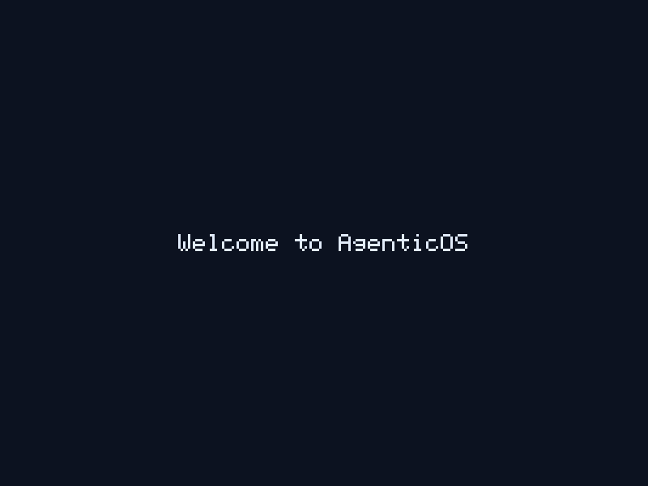

# Week 5 / Phase 5 acceptance report

Date: 2026-11-17. Scope: tasks and scheduling, following the owner's instruction
to complete the next task. Development branch: `feature/phase-5-scheduler`.

## Result

**Phase 5 passed for the documented single-CPU QEMU target.** AgenticOS 0.5.0
has PCB/TCB state, cooperative and timer-preempted round robin, guarded worker
stacks, exit status, blocking join, cancellation, timed sleep, an idle HLT path,
mutexes and bounded semaphores. A common saved interrupt frame supplies actual
CPU context switching through IRETQ. Every current PCB borrows the kernel CR3;
these are kernel tasks, not isolated user processes.

The final full suite passed: **12 scheduler guest checks**, all **14 memory**
and **18 interrupt** guest checks, sanitized host algorithms, default BIOS/UEFI
boots, GDB and the existing foundation/reconfiguration regressions. Four of the
12 scheduler cases deliberately halt on a guard fault or watchdog. They are
successful host tests of expected failure, not successful normal boots.

Normal boot completes the task exercises, joins/reclaims their resources,
masks the PIC, emits PHASE5 PASS and halts with IF clear. It does not start a
persistent user environment or AI service.



The final BIOS/128 MiB scheduler run captured this actual 800x600 framebuffer,
with 2,124 foreground pixels. Its wording was visually inspected. That run's
normal-scenario ELF matches the default acceptance ELF by SHA-256.

## Commands executed

From `/workspace/AGENTIC-OPERATING-SYSTEM`, using the existing pinned Debian
Clang/LLD 19.1.7, NASM 2.16.03, QEMU 10.0.13 and GDB 16.3 toolchain:

```sh
./scripts/env.sh make test                 # establish the Week 4 baseline
git fetch origin main
git switch -c feature/phase-5-scheduler

# Final acceptance, including the added real join-cycle exercise:
./scripts/env.sh make -j2 iso
./scripts/env.sh make test test-debug test-foundation test-memory test-interrupts test-scheduler
```

The checkout and remote main initially matched Week 4 commit `4b362d7`.
No dependencies were installed, no physical disks were attached or modified,
and cloud configuration was not changed or published. Earlier acceptance
reports and screenshots retain their historical contents.

## Validation evidence

| Check | Observed outcome |
| --- | --- |
| Freestanding C17/NASM, strict warnings as errors and static W^X ELF layout | Passed |
| PCB capacity, shared root, retained thread counts, names and monotonic/stale IDs | Passed under ASan/UBSan |
| Circular fairness, one RUNNING task, cooperative ticks and two-tick preemption | Passed under ASan/UBSan |
| Sleep deadlines, oldest waiter, wait-object isolation and idle fallback | Passed under ASan/UBSan |
| Join wake/cancellation, including a cancelled already-woken joiner | Passed under ASan/UBSan |
| Off-stack reap, lock-owner rejection and counter/ID overflow handling | Passed under ASan/UBSan |
| All four stack allocation and four map failure points | Exact rollback passed under ASan/UBSan |
| Physical frame zero, occupied guard rejection and stack destruction | Passed under ASan/UBSan |
| Cooperative task order and CPU context | ABABAB; all 15 high-bit GPRs, RSP, CF/DF and stack-local data preserved |
| Three non-yielding workers | All progressed, accumulated runtime ticks, and required positive timer-driven switches |
| Mutex contention/handoff and invalid operations | Eight protected updates, recursive/nonowner rejection and owner cancellation rejection passed |
| Semaphore wait/post/overflow | Two tokens consumed; overflow rejected with no lost wakeup |
| Sleep/idle, child spawn/blocking join and cancellation | Passed in every normal/stress round |
| Two running tasks attempting a join cycle | Cycle rejected; second exited and first consumed its status without deadlock |
| Stack/frame/table cleanup | Every completed round restored all three pre-task resource counts |
| Real physical exhaustion during spawn | Stress image rejected spawn without publishing a TID, recovered every frame and completed subsequent task rounds |
| Actual task guard and runaway watchdog | Expected fatal outcomes verified; no PHASE5 marker |
| Default BIOS/UEFI and GDB hardware breakpoint at kernel_main | Passed |
| Existing diagnostics, configuration, framebuffer, memory and runtime tests | Passed; sanitizer checks retained |
| Eight foundation diagnostic boots and configuration restoration | Passed; restored ELF hash matched and normal BIOS boot passed |
| Fourteen memory and eighteen interrupt guest checks | Passed, including prior expected-fault and readiness tests |
| Task guard image presented to normal readiness after PHASE4 | Correctly rejected with exit 1 |

The scheduler matrix's **12 guest checks** were:

| Image | BIOS RAM | UEFI RAM | Observed outcome |
| --- | --- | --- | --- |
| Normal | 32, 128, 512 MiB | 128, 256, 512 MiB | Six PHASE5 completions |
| Stress | 128 MiB | 128 MiB | Four rounds each, one-tick quantum, real OOM/recovery, PHASE5 |
| Task guard | 128 MiB | 128 MiB | Real #PF vector 14/error 0 at the lower task guard |
| Runaway | 128 MiB | 128 MiB | Timer-driven watchdog panic after the delivered-tick bound |

Every scheduler run also checked actual GDT/IDT/TR and TSS busy memory, CR3,
WP/NXE, ordered diagnostics, one kernel entry, final high-kernel HLT/CPL 0/IF
clear, and the actual welcome capture. Fatal guard checks verified saved IF
was set in the interrupted worker and its saved RSP lay inside its valid stack.
Normal readiness requires PHASE5, so PHASE4 alone cannot hide a scheduler fault.

Final BIOS/128 MiB normal serial excerpt:

```text
[19] [INFO] [scheduler-test] capacity=15; invalid/capacity failures, cancellation and stack guards passed
[20] [INFO] [scheduler-test] cooperative round=1 order=ABABAB; 15 GPRs/RSP/CF/DF, separate stacks and exit status passed
AGENTICOS: COOPERATIVE PASS
[21] [INFO] [scheduler-test] preemptive round=1 workers=3 timer_switches=6 quantum=2; non-yielding progress and 15 GPRs/RSP/DF passed
AGENTICOS: PREEMPT PASS
[22] [INFO] [scheduler-test] sync round=1 mutex_updates=8 tokens=2; sleep/idle, blocking join, cancellation and stale handles passed; join cycles passed
AGENTICOS: SYNC PASS
[23] [INFO] [scheduler-test] reclaim round=1 free_frames=32133 table_pages=75 mappings=33219; no task resources retained
AGENTICOS: RECLAIM PASS
[24] [INFO] [boot] Task foundation initialized; halting
AGENTICOS: PHASE5 PASS
```

In the final UEFI stress run, spawn OOM exhausted/recovered 30,535 free frames.
Each of its four rounds observed nine timer-driven switches at quantum 1 and
restored 30,535 free frames, 75 table pages and 32,269 mappings. Counts differ
between firmware/memory configurations; comparisons are against each run's own
baseline. A round must finish with no live tasks and the bootstrap context active.

Separate expected-failure excerpts:

```text
[19] [PANIC] [exception] vector=14 name=page fault error=0x0 rip=0xffffffff8000b5f2 cr2=0xffffd20000006000
[19] [PANIC] [panic] kernel/scheduler/task.c:149 scheduler_interrupt: scheduler watchdog expired
```

The first is the BIOS guard image and ends in EXCEPTION HALT; the second is the
UEFI watchdog image. Both had completed PHASE4 and neither emitted PHASE5 PASS.
Their failure-generating worker code is excluded from the normal kernel.

Generated evidence is in `build/tests/scheduler-{firmware}-{scenario}-{RAM}m/`:
exact QEMU argv/RAM and ISO/ELF hashes in `command.json`, serial/emulator output,
CPU registers, actual GDT memory and framebuffer captures. Other suites retain
separate evidence. The full final log is saved locally as
`build/week5-validation.log`; the negative normal-readiness output is
`build/tests/scheduler-runner-negative.log`. Runners remove stale known outputs,
enforce deadlines, require clean QMP exit and clean up only their own processes.

## Default artifacts from the final acceptance run

| Artifact | Size | SHA-256 |
| --- | ---: | --- |
| `build/agenticos.iso` | 4,108,288 bytes | `d5efb6e6265abf1dbb327c35d26abad89f15d7d8afcd914fc6a3e25650afc844` |
| `build/kernel.elf` | 233,880 bytes | `7c34761266d575881dfe3aec2c0f15931929e2039d69bb2da365dd045d5f11e5` |

Generated binaries/raw logs are ignored by Git. Source, tests, explanations,
this report and the actual screenshot are committed. ISO timestamps remain
unnormalized, so a later rebuild can have a different ISO hash.

## Implementation map and limits

- `kernel/process/process.*`: bounded kernel PCB groups and thread ownership.
- `kernel/scheduler/core.*`: portable state, round robin, waits and reclamation policy.
- `kernel/scheduler/stack.*`: guarded stack ownership and partial-allocation rollback.
- `kernel/scheduler/task.*`: IRQ-serialized runtime, frame selection, lifecycle,
  sleep/idle/watchdog, mutex handoff and semaphore wakeups.
- `kernel/scheduler/selftest.c`, `arch/x86_64/task_probe.asm`: real task/data/
  register/synchronization exercises, including a non-yielding assembly worker.
- Interrupt dispatch/stubs: acknowledge timer IRQs before selecting another
  saved frame. Heap wrappers preserve IF around shared metadata edits.
- `tests/scheduler*` and the test-only guest probe: sanitizers, RAM/firmware,
  real failure cases, stress/OOM and rejection of premature readiness.

See [the scheduling walkthrough](../SCHEDULING.md) for lifecycle, stack safety,
context frames, IRQ serialization, join ownership and synchronization contracts.

These kernel tasks share ring 0 and CR3; PCB groups are not security boundaries.
There is no user loader, syscall ABI, per-process page table, FPU/SIMD context,
SMP/APIC scheduling, priority policy or general deadlock recovery. Mutex owners
cannot be cancelled; exit with held mutexes is fatal. Borrowed arguments and
synchronization objects must outlive their users. The watchdog needs delivered
timer IRQs; it cannot recover a task that permanently disables interrupts.
Semaphores wake all waiters and do not promise strict FIFO acquisition.

Use at least 128 MiB for UEFI; prior low-memory firmware/loader failures remain
documented in Week 3 and are not accepted targets. Physical hardware, Secure
Boot, persistent services and AI functionality remain unverified/unimplemented.

**Next milestone: Phase 6 / Week 6 — user mode and syscalls, pending owner approval.**
