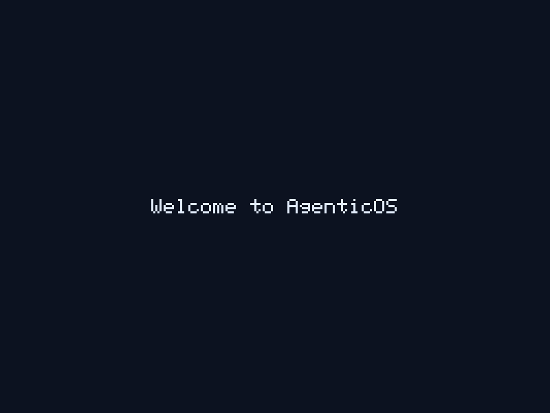

# Week 6 / Phase 6 acceptance report

Date: 2026-11-18. Scope: user mode, process isolation, validated syscalls and
native programs, following the owner's instruction to complete the next task.
Development branch: `feature/phase-6-user-mode`.

## Result

**Phase 6 passed for the documented single-CPU QEMU target.** AgenticOS 0.6.0
loads native C ELF64 programs into separate lower-half address spaces and
executes them at CPL 3. It selects CR3/TSS.RSP0 with tasks, provides bounded
write/read/exit/getpid/yield syscalls, validates buffers and return contexts,
and contains ordinary user faults while a guardian process completes.

The final full suite passed: **12 user guest checks**, the existing **12
scheduler**, **18 interrupt** and **14 memory** guest checks, sanitized host
algorithms, default BIOS/UEFI boots, GDB and foundation/reconfiguration tests.
Normal boot includes eight intentionally offending user programs; each is
terminated and reaped without a kernel panic. Two separate invalid-required-
image runs deliberately end in a kernel assertion. Those are expected host
failure tests, not successful normal boots.

The native programs finish, user pages/roots/stacks are reclaimed, kernel CR3
is restored, PHASE6 PASS is emitted and the kernel halts with IRQs masked/IF
clear. There is no persistent shell, filesystem or AI service yet.



The final BIOS/128 MiB user run captured this actual 800x600 framebuffer with
2,124 foreground pixels; its wording was visually inspected. Its normal-scenario
kernel ELF matches the default acceptance ELF by SHA-256. The runner also saved
an independent CPU capture while CPL 3 was live, before the final kernel halt.

## Commands executed

In `/workspace/AGENTIC-OPERATING-SYSTEM`, using the existing pinned Debian
Clang/LLD 19.1.7, NASM 2.16.03, QEMU 10.0.13 and GDB 16.3 tools:

```sh
./scripts/env.sh make test                 # establish the Week 5 baseline
git fetch origin main
git switch -c feature/phase-6-user-mode

# Final acceptance after implementation, review and the UART fix:
./scripts/env.sh make -j2 iso
./scripts/env.sh make test test-debug test-foundation test-memory test-interrupts test-scheduler test-user
```

The checkout and remote main initially matched Week 5 commit `db14368`.
No dependencies were installed, no physical disks were attached/modified,
and cloud configuration was not changed or published. Earlier reports and
screenshots retain their historical contents.

## Validation evidence

| Check | Observed outcome |
| --- | --- |
| Freestanding kernel/native C/NASM and static W^X ELF layout | Passed with strict warnings as errors |
| Actual native ELF plus fourteen malformed variants | Passed under ASan/UBSan: bounds/overflow, W^X, overlaps, dynamic/TLS/exec-stack rejection |
| Effective parent USER/WRITE, borrowed supervisor kernel mappings | Passed under ASan/UBSan |
| Cross-page copies, NULL/kernel/overflow/readonly/straddling buffers | Rejected correctly; no partial bad-destination modification |
| BSS/padding, stack guards, private roots/data and info page | Passed under ASan/UBSan |
| Loader allocation budgets 0 through 32 | Exact rollback/recovery; kernel-owned upper tree remained intact |
| User IRET selectors/addresses and dangerous flag removal | Passed under ASan/UBSan |
| Actual CPL3 CPU state and private CR3 | Independently captured by QMP in every successful user run |
| Native hello and two copies of the same native probe | Correct PID, ring-3 selectors, independent data and five syscalls |
| User timer preemption | Each normal copy accumulated at least six actual CPL3 timer entries while spinning without yield |
| Console read/write | Empty nonblocking read, stdout/stderr, 128-byte maximum write, and actual injected Z received/echoed |
| Syscall errors | Unknown number, bad fd/size/pointer and invalid exit range returned the expected errors |
| Eight offender/guardian cases | Offender reaped with expected status; guardian completed and kernel survived |
| Four-round stress and real partial-loader OOM | Passed on BIOS and UEFI with exact frame recovery |
| User teardown | Original frame/table/mapping counts and kernel CR3 restored |
| Invalid required user image after PHASE5 | Expected assertion; no PHASE6; normal checker rejected with exit 1 |
| Existing sanitizer, default boot, GDB and eight foundation diagnostic checks | Passed |
| Existing 14 memory, 18 interrupt and 12 scheduler guest checks | Passed, including their earlier expected failures and readiness rejection |
| Same-directory configuration restoration | Restored normal ELF hash matched; restored BIOS boot passed |

The user matrix executed these **12 guest checks**:

| Image | BIOS RAM | UEFI RAM | Observed outcome |
| --- | --- | --- | --- |
| Normal | 32, 128, 512 MiB | 128, 256, 512 MiB | Six complete CPL3/syscall/containment/reclaim boots |
| Stress | 128 MiB | 128 MiB | Four private-root rounds, partial-load OOM rollback, PHASE6 |
| Console input | 128 MiB | 128 MiB | SYS_READ received host Z and SYS_WRITE echoed it; PHASE6 |
| Required-image rejection | 128 MiB | 128 MiB | Expected kernel assertion after PHASE5, no PHASE6 |

Final BIOS/128 MiB native entry and private-data excerpts:

```text
[25] [INFO] [user-enter] case=hello pid=7 cr3=0x1d4000 cs=0x2b ss=0x33 rsp0=0xffffd2000000b000 frame=0xffffd2000000af50
[33] [INFO] [user-test] round=1 roots=0x1e9000,0x1fe000 data_frames=0x1ef000,0x204000; CPL3 preemption, private data and five checked syscalls passed
```

The independent CPU capture for that run showed:

```text
RSP=0000000070003f50
RIP=000000000040039d RFL=00000293 CPL=3 HLT=0
CS=002b DPL=3 CS64
SS=0033 DPL=3
CR0=8001001d CR3=00000000001e9000 CR4=00000020
EFER=0000000000000d00
```

These are selected fields from the actual dump, with spacing shortened for
readability. User CS/SS and the user CR3 differ from the final kernel context.
CR0.WP/EM/TS and EFER.NXE are set; user IOPL is zero. At completion the original
kernel CR3 `0x55000` was restored and the CPU was halted at CPL 0 with IF clear.

Contained faults checked in each successful run:

| Offender | Required CPU/policy result | Exit status |
| --- | --- | ---: |
| Read kernel mapping | #PF vector 14/error 0x5, CR2 0xffffffff80000000 | -270 |
| Read peer-only private page | #PF 14/error 0x4, CR2 0x60000000 | -270 |
| Write read-only constants | #PF 14/error 0x7 | -270 |
| Fetch NX data | #PF 14/error 0x15, RIP=CR2 | -270 |
| CLI | #GP 13/error 0 | -269 |
| Invoke kernel gate | #GP 13/error 0x40a | -269 |
| Use unsaved SIMD state | #UD 6/error 0 | -262 |
| Noncanonical return RSP | Rejected before kernel IRET | -300 |

Examples from the final BIOS normal run:

```text
[36] [WARNING] [user-fault] case=kernel pid=11 vector=14 error=0x5 rip=0x400064 cr2=0xffffffff80000000 cs=0x2b; process terminated
[78] [WARNING] [user-fault] case=context pid=25 reason=context rip=0x4000b0 rsp=0x800000000000; process terminated
[82] [INFO] [user-test] reclaimed all processes: frames=32101 tables=75 mappings=33231; kernel CR3 restored
```

The UEFI stress run recovered 30,500 frames after a deliberately partial loader
failure, completed four private-root rounds, then restored 30,500 free frames,
75 table pages and 32,282 mappings. Counts are compared with each run's own
baseline, not across firmware/build variants.

The final UEFI input run recorded `text="Z" bytes=1`, USER READ PASS and PHASE6.
An earlier input run received Z but exposed missing serial characters, including
a byte of the final marker, under the old transmit polling bound. It correctly
failed by timeout. A separate bounded transmit budget of 1,000,000 spins replaced
the former 100,000-spin transmit limit; the complete BIOS/UEFI I/O checks and
full regression suite subsequently passed. No incomplete marker was accepted.

Evidence is under `build/tests/user-{firmware}-{scenario}-{RAM}m/`: exact argv,
RAM, ISO/ELF hashes and input actions in `command.json`, live `user-registers.txt`,
final registers/GDT memory, serial/emulator logs and actual framebuffer captures.
The final aggregate log is saved locally as `build/week6-validation.log`; normal
rejection output is `build/tests/user-runner-negative.log`. Runners clear known
stale files, enforce deadlines, require clean QMP exit and clean up their own VMs.

## Artifacts from the final acceptance run

| Artifact | Size | SHA-256 |
| --- | ---: | --- |
| `build/agenticos.iso` | 4,192,256 bytes | `983a986b44a2f16e396e915c126a87b356ec8bd6f4d9f3316aa0e9993957b33c` |
| `build/kernel.elf` | 317,880 bytes | `6c63596b833eca09aeb86dcaa9e7cb4de936b2fd137a0133ae714fca38954546` |
| `build/user/hello.elf` | 11,608 bytes | `20e063257ad0fd813800ec813a37f5b799123de9e393fe1e2ac03c7af75b1a52` |
| `build/user/probe.elf` | 19,208 bytes | `69028bf68d7675f9b2cea93cd2ce07006d39885e4e72f6398e0d276939fb10bf` |

Generated binaries/raw logs are ignored by Git. Source, tests, explanations,
this report and the actual screenshot are committed. ISO timestamps remain
unnormalized, so later rebuilds can have a different ISO hash.

## Implementation and remaining scope

`kernel/user` owns ELF plans, user pages/copies, return policy, process teardown
and containment. `kernel/syscall` defines the shared native ABI and validates
console/process calls. Descriptor/interrupt/scheduler changes load ring-3
selectors, select CR3/TSS.RSP0 and return the chosen frame. `userland/runtime`
and `applications` produce the two native programs. Kernel-template GP probes
now use selector 0x38 because the GDT grew to seven entries; earlier reports
retain the old selector results as historical evidence.

See [user mode and the syscall ABI](../USER_MODE.md) for permissions, copying,
resource ownership and return-state details. The supported target remains one
QEMU CPU, with one task per user PCB and bootstrap-managed creation/reaping.
The upper kernel tree is borrowed under an explicit lifetime contract. There
is no SMP refcount/shootdown policy, demand paging, fork/exec, dynamic/TLS ABI,
signal system, general file table or floating-point context support.

FPU/MMX/SIMD use traps rather than sharing unsaved state; this is a GPR-only
native ABI. Read is nonblocking and write is filtered/sanitized diagnostic text.
UART delivery remains bounded/best effort. General NMI/DF/machine-check recovery,
physical hardware, Secure Boot and production security are unverified. Use at
least 128 MiB for UEFI; earlier low-RAM loader failures are historical Week 3
limitations. Filesystems, networking, desktop and AI functionality remain future
milestones.

**Next milestone: Phase 7 / Week 7 — VFS and RAM filesystem, pending owner approval.**
